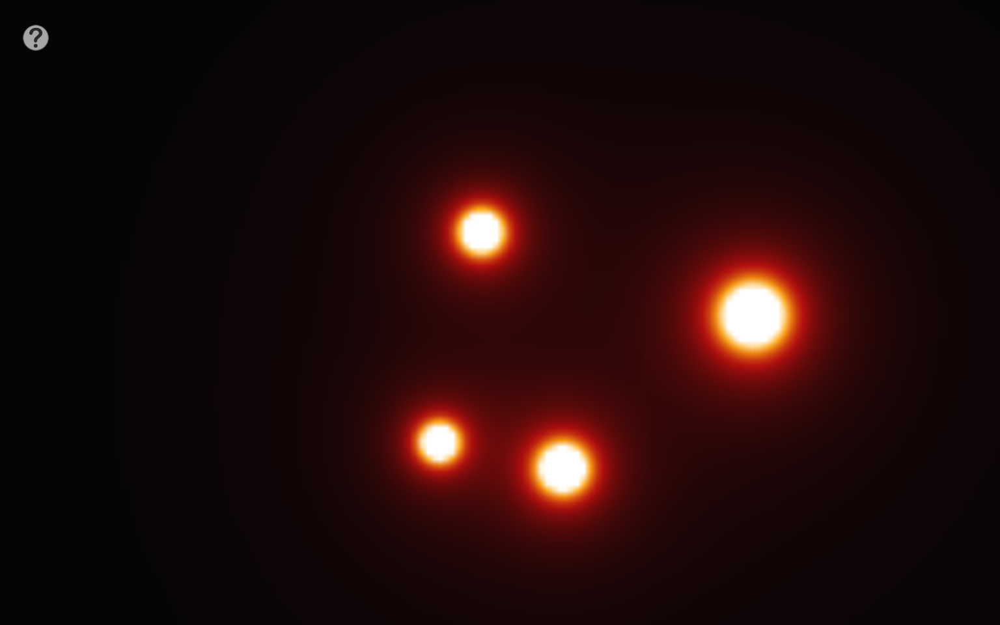
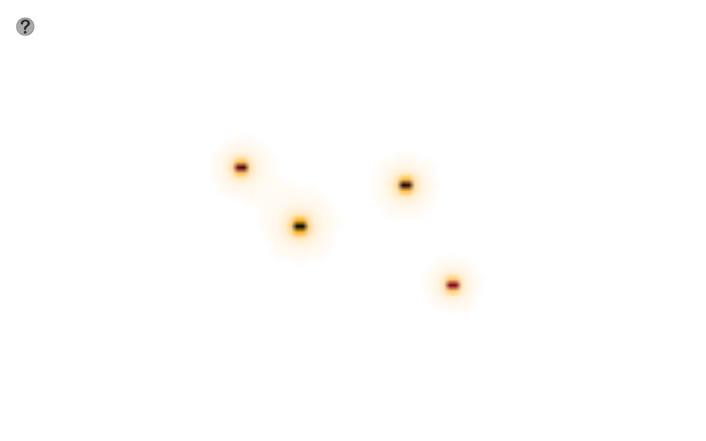
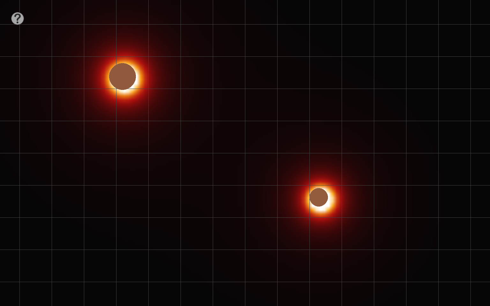
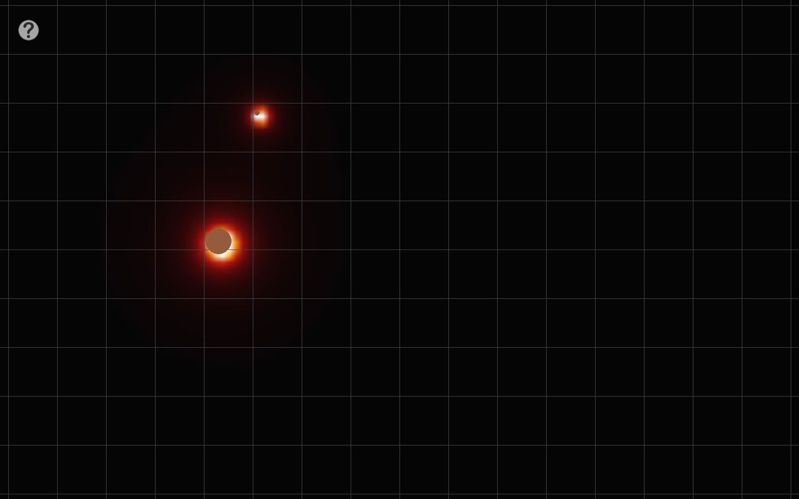

<div align="center">
  
  <h1>Gravitum</h1>
  <p>Un simulador interactivo 2D para crear cuerpos, observar su atracción y explorar el campo gravitatorio.</p>
</div>

Gravitum permite experimentar con sistemas de varios cuerpos: ajusta sus velocidades, observa cómo interactúan y cambia la forma de ver el campo.

## Campo en dos paletas

La captura oscura oculta los cuerpos para destacar el campo; la clara los muestra como referencia. Ambas se capturaron a 1536 × 960.

| Paleta oscura · solo el campo | Paleta clara · campo y cuerpos |
| --- | --- |
|  |  |

## De dos cuerpos a muchos

La cuadrícula se puede activar o quitar según lo que quieras observar. Las dos imágenes muestran la misma configuración de dos cuerpos.

| Con cuadrícula | Sin cuadrícula |
| --- | --- |
|  |  |

Con más entidades, las zonas de intensidad se combinan alrededor de todo el sistema:

<p align="center">
  
</p>

## Colisiones y órbitas

En esta secuencia, dos cuerpos se acercan con velocidades iniciales, colisionan y continúan su movimiento. El GIF está reducido a 768 × 480 para que cargue con más facilidad.

<p align="center">
  
</p>


El modo orbital asistido asigna una velocidad inicial tangencial al segundo cuerpo. El GIF muestra un tramo de esa evolución en el simulador.

<p align="center">
  
</p>



## Cómo probarlo

1. Mantén pulsado el botón central del ratón y arrastra para crear un cuerpo; la distancia del arrastre determina su tamaño.
2. Haz clic derecho sobre un cuerpo y arrastra para darle una velocidad inicial; la flecha indica su dirección.
3. Pulsa `F` para mostrar u ocultar el campo y `T` para recorrer sus paletas de color.
4. Para probar el modo orbital, pulsa `O`, selecciona primero el cuerpo central y luego el cuerpo al que quieres asignar la velocidad orbital.

## Controles principales

| Control | Acción |
| --- | --- |
| Clic izquierdo y arrastrar | Seleccionar y mover un cuerpo |
| Clic central y arrastrar | Crear un cuerpo |
| Clic derecho y arrastrar sobre un cuerpo | Definir su velocidad inicial |
| Clic derecho y arrastrar en el fondo | Desplazar la cámara |
| `P` | Pausar o reanudar la simulación |
| `F` / `T` | Ocultar o mostrar el campo / cambiar su paleta |
| `D` / `G` / `A` | Mostrar detalles / cuadrícula / ejes |
| `C` / `R` / `K` | Centrar cámara / encuadrar cuerpos / reiniciar |
| `O` | Activar el modo de velocidad orbital asistida |
| `Espacio` / `Tab` | Acelerar mientras se mantiene pulsada la tecla |
| `B` | Invertir el sentido del tiempo mientras se mantiene pulsada |
| `H` | Abrir o cerrar la ayuda |
| `Esc` | Salir |

## Ejecutar en Windows

Con Python instalado, crea un entorno e instala las dependencias:

```powershell
python -m venv .venv
.\.venv\Scripts\Activate.ps1
python -m pip install pygame numpy opencv-python scipy numba pywin32
python files\main.py
```

README y recursos visuales preparados con asistencia de IA. Las capturas se obtuvieron ejecutando el simulador; el código del proyecto no se modificó.
