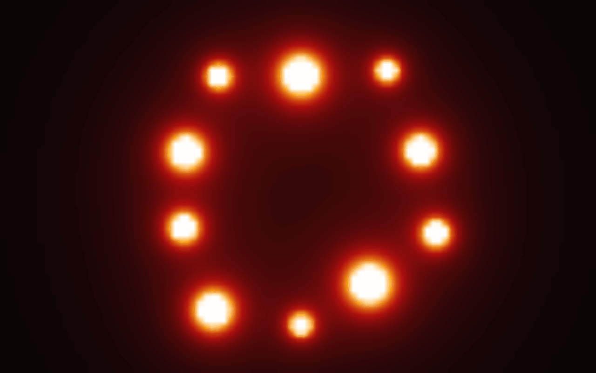
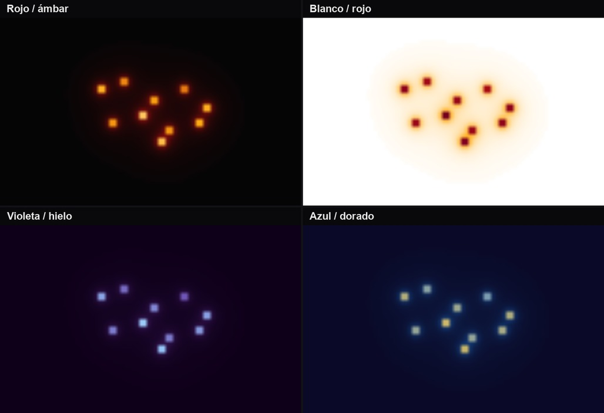
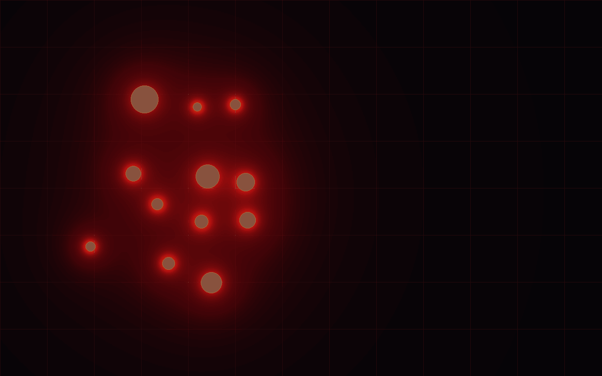
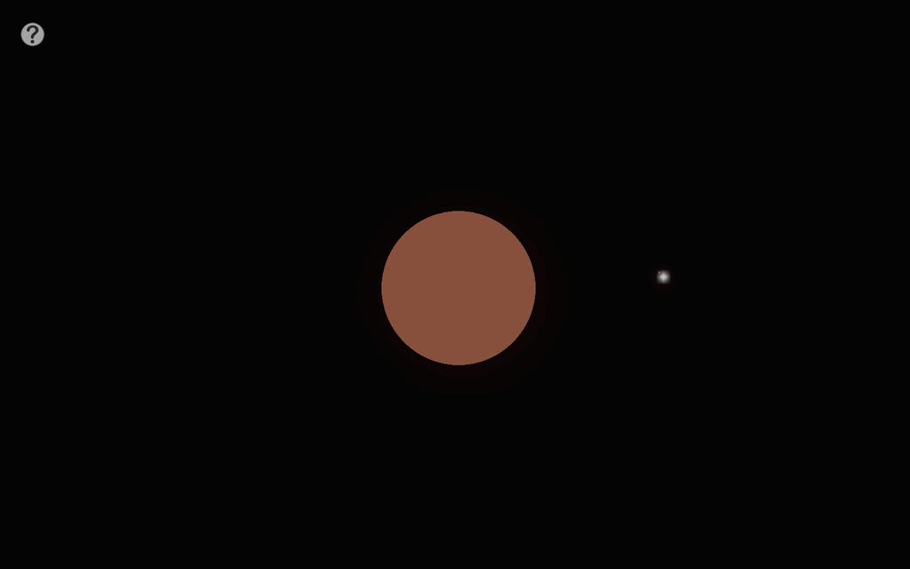
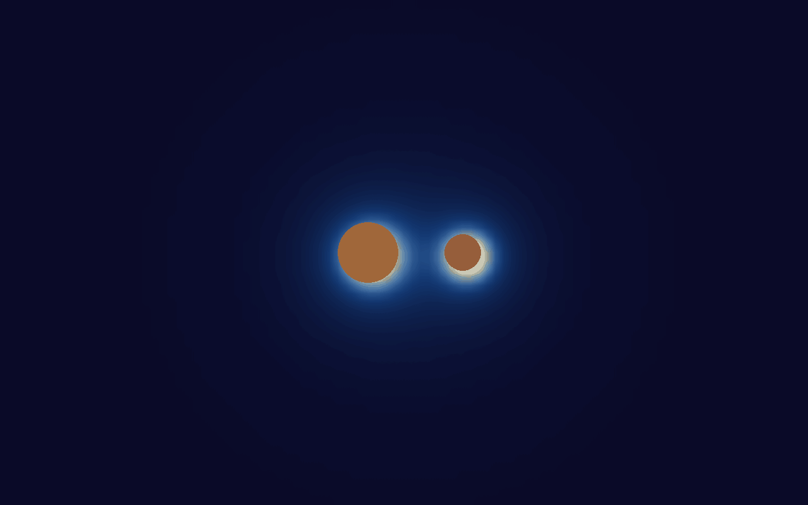
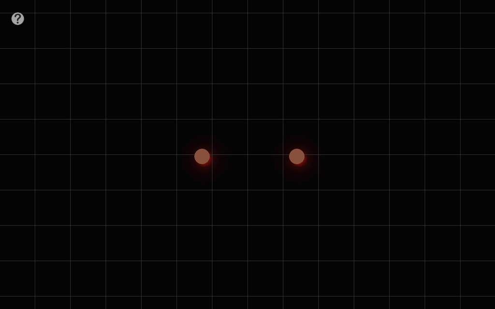
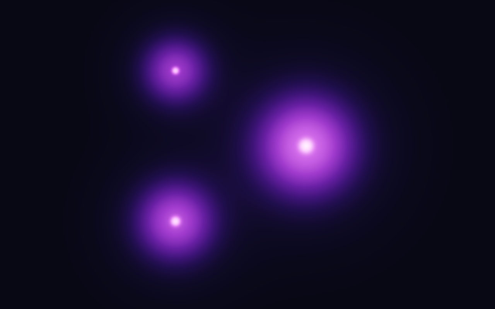

<div align="center">
  
  <h1>Gravitum</h1>
  <p>Un simulador interactivo 2D para crear cuerpos, observar su atracción y explorar el campo gravitatorio.</p>
</div>

<p align="center">
  
</p>

Gravitum permite experimentar con sistemas de varios cuerpos: ajustar sus velocidades, observar cómo interactúan y cambiar la forma de ver el campo.

## Más cuerpos, cuatro paletas

Cambia la paleta y añade cuerpos para ver cómo se superponen sus campos. La cuadrícula también se puede activar para orientar las posiciones.

<table width="100%">
  <tr>
    <th width="50%">Cuatro paletas de campo</th>
    <th width="50%">Doce cuerpos y cuadrícula</th>
  </tr>
  <tr>
    <td width="50%" valign="top">
      
    </td>
    <td width="50%" valign="top">
      
    </td>
  </tr>
</table>

## Órbitas

El modo orbital asistido asigna una velocidad inicial tangencial al cuerpo seleccionado. La animación de la derecha muestra una órbita binaria más cerrada, con ambas masas girando alrededor de su centro de masa.

<table width="100%">
  <tr>
    <th width="50%">Órbita asistida</th>
    <th width="50%">Órbita binaria</th>
  </tr>
  <tr>
    <td width="50%" valign="top">
      
    </td>
    <td width="50%" valign="top">
      
    </td>
  </tr>
</table>

## Colisiones

La primera animación muestra dos cuerpos que se aproximan y rebotan; la segunda cambia a la paleta violeta y sigue tres cuerpos que orbitan hasta fusionarse.

<table width="100%">
  <tr>
    <th width="50%">Colisión</th>
    <th width="50%">Tres cuerpos, una fusión</th>
  </tr>
  <tr>
    <td width="50%" valign="top">
      
    </td>
    <td width="50%" valign="top">
      
    </td>
  </tr>
</table>

## Cómo probarlo

1. Mantén pulsado el botón central del ratón y arrastra para crear un cuerpo; la distancia del arrastre determina su tamaño.
2. Haz clic derecho sobre un cuerpo y arrastra para darle una velocidad inicial; la flecha indica su dirección.
3. Pulsa `F` para mostrar u ocultar el campo y `T` para recorrer sus paletas de color.
4. Para probar el modo orbital, pulsa `O`, selecciona primero el cuerpo central y luego el cuerpo al que quieres asignar la velocidad orbital.

## Controles principales

| Control | Acción |
| --- | --- |
| Clic izquierdo y arrastrar | Seleccionar y mover un cuerpo |
| Clic central y arrastrar | Crear un cuerpo |
| Clic derecho y arrastrar sobre un cuerpo | Definir su velocidad inicial |
| Clic derecho y arrastrar en el fondo | Desplazar la cámara |
| `P` | Pausar o reanudar la simulación |
| `F` / `T` | Ocultar o mostrar el campo / cambiar su paleta |
| `D` / `G` / `A` | Mostrar detalles / cuadrícula / ejes |
| `C` / `R` / `K` | Centrar cámara / encuadrar cuerpos / reiniciar |
| `O` | Activar el modo de velocidad orbital asistida |
| `Espacio` / `Tab` | Acelerar mientras se mantiene pulsada la tecla |
| `B` | Invertir el sentido del tiempo mientras se mantiene pulsada |
| `H` | Abrir o cerrar la ayuda |
| `Esc` | Salir |

## Ejecutar en Windows

Con Python instalado, crea un entorno e instala las dependencias:

```powershell
python -m venv .venv
.\.venv\Scripts\Activate.ps1
python -m pip install pygame numpy opencv-python scipy numba pywin32
python files\main.py
```

README y recursos visuales preparados con asistencia de IA a partir del proyecto. El código de Gravitum no se modificó.

> **Nota sobre el modelo gravitatorio:** La atracción y el campo se calculan tratando cada cuerpo como una masa puntual concentrada en su centro. El radio se usa para dibujarlo y detectar colisiones, pero no para distribuir la masa en su interior. Por eso, Gravitum no modela el campo dentro de una esfera de densidad uniforme, cuyo módulo crecería linealmente desde el centro.
