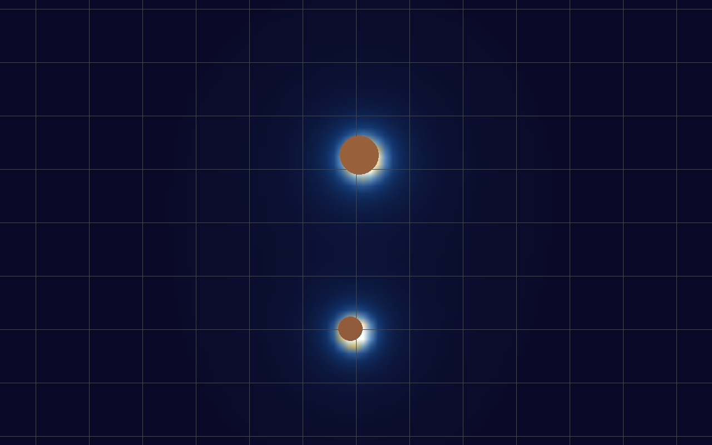

<div align="center">
  
  <h1>Gravitum</h1>
  <p>Un simulador interactivo 2D para crear cuerpos, observar su atracción y explorar el campo gravitatorio.</p>
</div>

Gravitum permite experimentar con sistemas de varios cuerpos: ajusta sus velocidades, observa cómo interactúan y cambia la forma de ver el campo.

## Diez cuerpos en colisión

Diez cuerpos de distintos tamaños ya están en movimiento desde el primer fotograma. Sus campos se superponen mientras chocan y se fusionan.

<p align="center">
  
</p>

## Más cuerpos, cuatro paletas

Cambia la paleta y añade cuerpos para ver cómo se superponen sus campos. La cuadrícula también se puede activar para orientar las posiciones.

<table width="100%">
  <tr>
    <th width="50%">Cuatro paletas de campo</th>
    <th width="50%">Doce cuerpos y cuadrícula</th>
  </tr>
  <tr>
    <td width="50%" valign="top">
      
    </td>
    <td width="50%" valign="top">
      
    </td>
  </tr>
</table>

## Colisiones y órbitas

La secuencia animada muestra dos cuerpos que se aproximan y rebotan; al lado, una captura fija permite ver el instante del choque con más detalle.

<table width="100%">
  <tr>
    <th width="50%">Dos cuerpos en movimiento</th>
    <th width="50%">El instante del contacto</th>
  </tr>
  <tr>
    <td width="50%" valign="top">
      
    </td>
    <td width="50%" valign="top">
      
    </td>
  </tr>
</table>

El modo orbital asistido asigna una velocidad inicial tangencial al cuerpo seleccionado. La primera vista muestra un cuerpo alrededor de una masa central; la segunda, dos cuerpos que orbitan su centro de masa, con otra paleta y la cuadrícula.

<table width="100%">
  <tr>
    <th width="50%">Órbita asistida</th>
    <th width="50%">Dos cuerpos · azul y dorado</th>
  </tr>
  <tr>
    <td width="50%" valign="top">
      
    </td>
    <td width="50%" valign="top">
      
    </td>
  </tr>
</table>

## Cómo probarlo

1. Mantén pulsado el botón central del ratón y arrastra para crear un cuerpo; la distancia del arrastre determina su tamaño.
2. Haz clic derecho sobre un cuerpo y arrastra para darle una velocidad inicial; la flecha indica su dirección.
3. Pulsa `F` para mostrar u ocultar el campo y `T` para recorrer sus paletas de color.
4. Para probar el modo orbital, pulsa `O`, selecciona primero el cuerpo central y luego el cuerpo al que quieres asignar la velocidad orbital.

## Controles principales

| Control | Acción |
| --- | --- |
| Clic izquierdo y arrastrar | Seleccionar y mover un cuerpo |
| Clic central y arrastrar | Crear un cuerpo |
| Clic derecho y arrastrar sobre un cuerpo | Definir su velocidad inicial |
| Clic derecho y arrastrar en el fondo | Desplazar la cámara |
| `P` | Pausar o reanudar la simulación |
| `F` / `T` | Ocultar o mostrar el campo / cambiar su paleta |
| `D` / `G` / `A` | Mostrar detalles / cuadrícula / ejes |
| `C` / `R` / `K` | Centrar cámara / encuadrar cuerpos / reiniciar |
| `O` | Activar el modo de velocidad orbital asistida |
| `Espacio` / `Tab` | Acelerar mientras se mantiene pulsada la tecla |
| `B` | Invertir el sentido del tiempo mientras se mantiene pulsada |
| `H` | Abrir o cerrar la ayuda |
| `Esc` | Salir |

## Ejecutar en Windows

Con Python instalado, crea un entorno e instala las dependencias:

```powershell
python -m venv .venv
.\.venv\Scripts\Activate.ps1
python -m pip install pygame numpy opencv-python scipy numba pywin32
python files\main.py
```

README y recursos visuales preparados con asistencia de IA a partir del proyecto. El código de Gravitum no se modificó.
